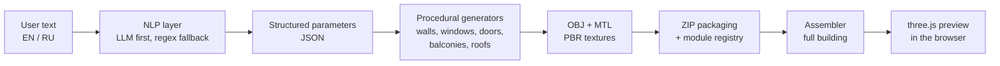

# Hi, I'm Oleksandr Chekhov 👋

**Python Backend Engineer · AI Software Developer**

I build backend systems with FastAPI and connect them to large language models like DeepSeek and Ollama to turn natural language into real, working output.
I recently graduated from university and I'm looking for my next role.

📍 Leipzig, Germany · open to opportunities worldwide
📫 [oleksandr.ch6@gmail.com](mailto:oleksandr.ch6@gmail.com) · [LinkedIn](https://www.linkedin.com/in/oleksandr-chekhov/)

---

## Featured project: 3D Object Maker

**Repository:** [ValeZh/3d_Object_Maker](https://github.com/ValeZh/3d_Object_Maker) · team project

### What it does

3D Object Maker turns plain-language descriptions into textured 3D buildings.
A user types something like *"gray wall 3 m high, 2 m wide"* or *"9-storey panel house with 3 entrances and balconies"*, in English or Russian.
The system understands the text, generates building parts, assembles them into a full house, and shows the result in the browser.

The web app has three tabs:

1. **Module Generator.** Describe a single part (wall, window, door, balcony, roof). The app extracts its parameters, generates a textured 3D model, and lets you adjust size and color.
2. **Module Library.** Browse, filter, sort, rename, delete, and download saved modules. Export or import the whole library as a ZIP.
3. **House Builder.** Describe a building or set floors, sections, width, depth, and balconies by hand. Pick modules from the library and generate the complete house, with a 3D preview and build animation.

<!-- Screenshot: drag an image of a generated building here in the GitHub editor. -->

### How it works

1. **Text understanding.** The description goes to an LLM, which returns structured JSON parameters. If the LLM is unavailable or returns bad output, a rule-based parser takes over, so the app keeps working.
2. **Generation.** Procedural generators build each module as an OBJ mesh with PBR texture maps (diffuse, normal, roughness).
3. **Packaging.** Each module is saved as a ZIP with its model and parameter file, and recorded in a JSON registry.
4. **Assembly.** The assembler places modules floor by floor and section by section, adding entrances, balconies, and a roof, and exports one building model.
5. **Preview.** The frontend loads the result with three.js so the user can rotate and inspect it.

### My contributions

**NLP and LLM integration**
- Built the **rule-based NLP parser** that extracts module types, dimensions, colors, materials, and options from English and Russian text using regular expressions.
- Integrated **DeepSeek** for module, building, and roof descriptions: prompt design, JSON extraction, value clamping, and validation.
- Designed the **fallback chain**: LLM first, regex parser if the API times out, runs out of credit, or returns malformed output.
- Integrated **Ollama** (a self-hosted LLM) to extract shape, texture, and color from free text for the early text-to-object prototype.

**Backend: FastAPI and REST API**
- Developed the **FastAPI server** that connects the NLP layer, the generators, and the frontend.
- Built **REST endpoints** for parsing, generation, the module library, and the house builder (see below).
- Added the **roof module** end to end: parser, generator config, and the `/api/generate-roof-module` endpoint. ([commit](https://github.com/ValeZh/3d_Object_Maker/commit/0c6b5acd1a040d1fe80e010ed3e4f1c6b629a6dd))

**3D pipeline**
- Worked on the **building assembler**, which combines wall, window, entrance, balcony, and roof modules into one building model.
- Implemented **ZIP packaging** of generated modules (model plus `config.json`) for download and reuse.

**Frontend**
- Fixed the logic behind the interface buttons so each action works reliably.
- Reworked the page flow and navigation so users understand each step more easily.

**Repository maintenance**
- Removed generated output and Python cache files from version control and tightened `.gitignore`.

### REST API overview

| Method | Endpoint | Purpose |
|---|---|---|
| `POST` | `/api/parse-module` | Extract module parameters from text |
| `POST` | `/api/generate-module` | Text → parameters → 3D module → ZIP |
| `POST` | `/api/generate-roof-module` | Generate a roof from text or a roof type |
| `GET` | `/api/modules` | List all saved modules, grouped by type |
| `GET` | `/api/modules/{type}` | List modules of one type |
| `GET` | `/api/modules/{id}/download` | Download a module ZIP |
| `PATCH` | `/api/modules/{id}` | Rename a module |
| `DELETE` | `/api/modules/{id}` | Delete a module |
| `POST` | `/api/analyze-building-text` | Extract building parameters from text |
| `POST` | `/api/generate-house` | Assemble a full building from modules |
| `GET` | `/api/houses` | List saved houses |
| `GET` | `/api/health` | Server health check |

### Project tech stack

Python · FastAPI · Uvicorn · REST API · DeepSeek API · Ollama · regex NLP · trimesh · OBJ/MTL · PBR textures · HTML/CSS/JavaScript · three.js · JSZip

---

## Skills

| Area | Technologies |
|---|---|
| **Languages** | Python, C++, C#, SQL, PHP, JavaScript |
| **Backend** | FastAPI, REST APIs, PostgreSQL, OAuth2, Docker, CI, Pytest, OOP, third-party API integration, .NET Framework |
| **Generative AI** | LLM API integration (DeepSeek), self-hosted LLMs (Ollama), RAG systems, prompt engineering, AI output evaluation and testing, NLP |
| **Tools** | Git, GitHub, Linux, Cursor, Claude Code |
| **Currently learning** | Postman, AWS |

## What I'm looking for

Roles as a **Python Backend Engineer** or **AI Software Developer** on products built around interesting ideas.
I'm based in Leipzig and open to teams anywhere in the world.
I'm not looking for roles in gambling, weapons, or the military and defense industry.

💬 Have a project in mind? Email me at [oleksandr.ch6@gmail.com](mailto:oleksandr.ch6@gmail.com).
